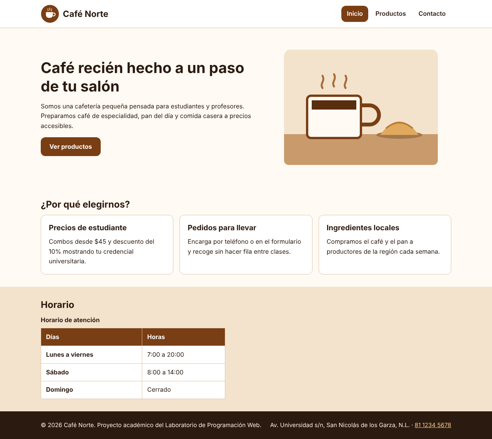
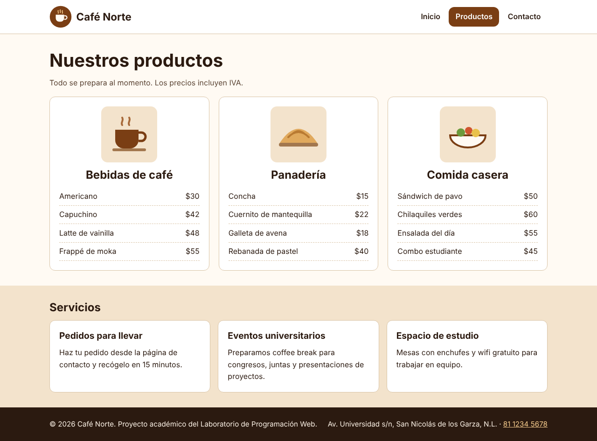
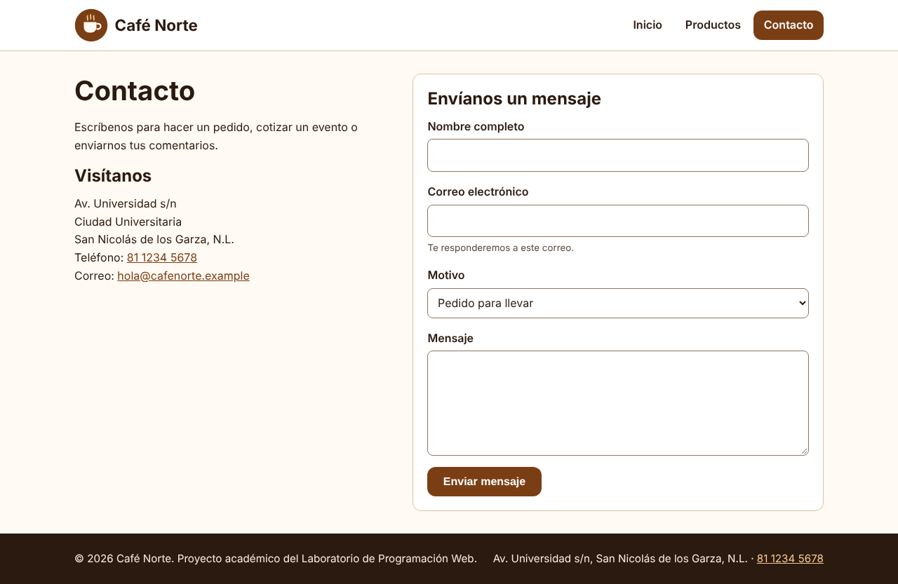
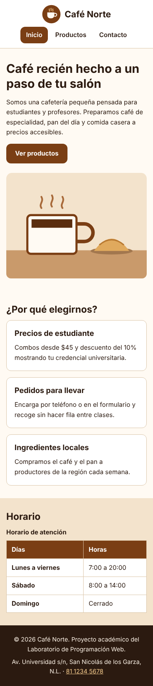
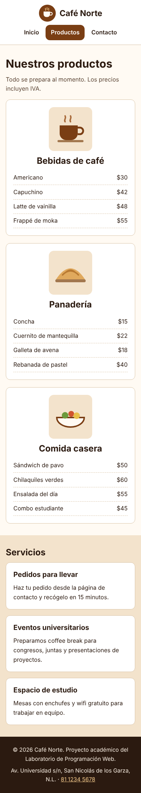
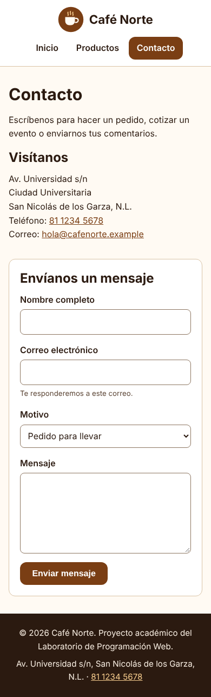
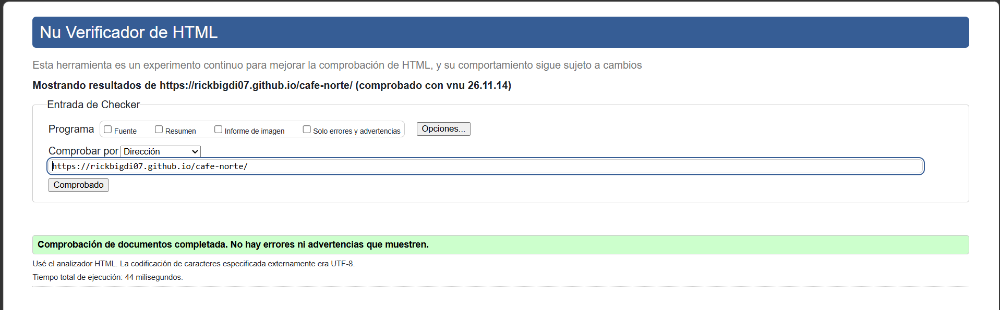
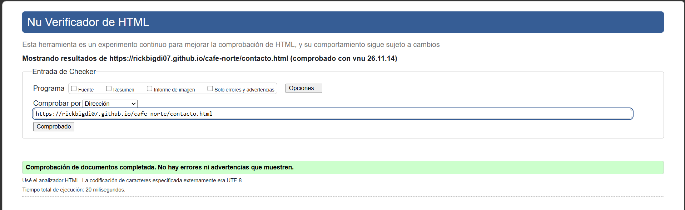
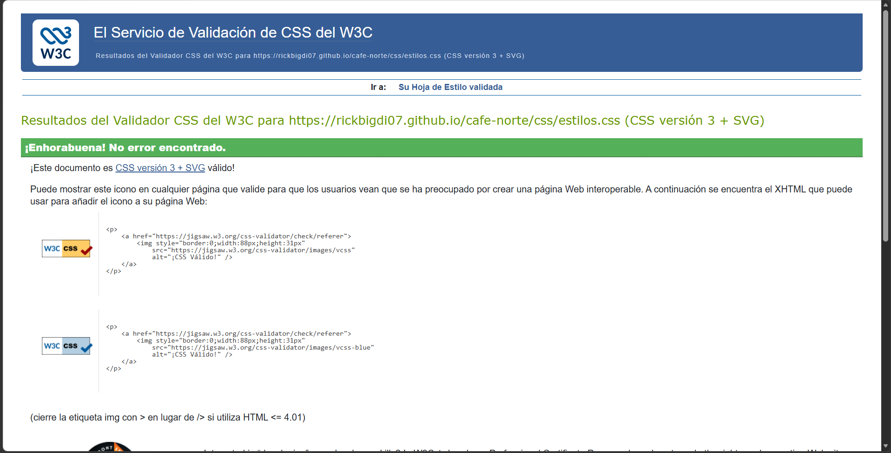

# Café Norte – Sitio web responsivo, semántico y accesible

Laboratorio de Programación Web · FIME, UANL
Actividad 2: Desarrollo de un sitio web responsivo, semántico y accesible

**Equipo**

- Ricardo Adiel Cuellar Cortez – 2169630 – ITS
- Josue Emiliano Diaz Garcia – 2226766 – ITS

**Sitio publicado:** https://rickbigdi07.github.io/cafe-norte/
**Repositorio:** https://github.com/rickbigdi07/cafe-norte


---

## Objetivo

Construir y publicar un sitio web responsivo con HTML5 semántico y CSS moderno para **Café Norte**, una cafetería universitaria ficticia que necesita presencia web para mostrar sus productos y recibir pedidos. El sitio debe verse bien en computadora y en teléfono, seguir buenas prácticas de usabilidad y accesibilidad, y validar sin errores en los validadores del W3C.

## Caso elegido

Cafetería universitaria. El sitio tiene tres vistas:

| Página | Archivo | Contenido |
| --- | --- | --- |
| Inicio | `index.html` | Presentación, ventajas de la cafetería y horario de atención |
| Productos | `servicios.html` | Menú con precios (bebidas, panadería y comida) y servicios |
| Contacto | `contacto.html` | Dirección, teléfono, correo y formulario de contacto |

## Tecnologías utilizadas

- **HTML5** con etiquetas semánticas.
- **CSS3**: variables CSS, Flexbox, CSS Grid y media queries.
- **SVG** para el logotipo y las ilustraciones (sin imágenes externas).
- **Visual Studio Code** como editor.
- **Git y GitHub** para el control de versiones.
- **GitHub Pages** para el despliegue.
- **W3C Markup Validation Service** y **W3C CSS Validation Service** para validar.

## Estructura del proyecto

```
cafe-norte/
├── index.html          Página de inicio
├── servicios.html      Productos y servicios
├── contacto.html       Contacto y formulario
├── css/
│   └── estilos.css     Hoja de estilo única (mobile first)
├── img/                Logotipo e ilustraciones SVG
├── capturas/           Capturas para este README
└── README.md
```

## Cómo se cumple cada criterio

### 1. Etiquetas semánticas de HTML5

Las tres páginas comparten la misma estructura:

- `<header>` con el logotipo y la navegación.
- `<nav aria-label="Navegación principal">` con una lista de enlaces.
- `<main id="contenido">` con el contenido propio de cada página.
- `<section>` para cada bloque temático, y `<article>` para elementos independientes (tarjetas de ventajas, categorías de productos, servicios).
- `<footer>` con derechos y datos de contacto dentro de `<address>`.

No se usan tablas para el diseño; la única tabla (`index.html`) es de datos (horario) y tiene `<caption>`, `<thead>` y encabezados con `scope`.

### 2. Diseño con Flexbox y Grid

- **Flexbox**: barra del encabezado, menú de navegación, tarjetas de producto, renglones de la lista de precios, campos del formulario y pie de página.
- **Grid**: portada (texto + imagen), tarjetas de ventajas y servicios, cuadrícula de productos y la página de contacto (datos + formulario).

### 3. Diseño responsivo

La hoja de estilo está escrita *mobile first*: por defecto todo se muestra en una columna. Con el breakpoint `@media (min-width: 768px)`:

- El encabezado pasa de columna a fila (logo a la izquierda, menú a la derecha).
- La portada se divide en dos columnas.
- Tarjetas y productos pasan a una cuadrícula de 3 columnas.
- La página de contacto muestra datos y formulario lado a lado.

Todas las páginas incluyen `<meta name="viewport" content="width=device-width, initial-scale=1">` y las imágenes usan `max-width: 100%`.

### 4. Accesibilidad

- `lang="es"` en todas las páginas y `<title>` distinto por página.
- Jerarquía de encabezados correcta: un solo `<h1>` por página, después `<h2>` y `<h3>`.
- Todas las imágenes tienen `alt`. El logo usa `alt=""` porque el nombre "Café Norte" ya aparece como texto junto a él.
- Formulario con `<label for>` en cada campo, `required`, `autocomplete` y texto de ayuda enlazado con `aria-describedby`.
- Enlace "Saltar al contenido principal" visible al navegar con teclado.
- La página actual se marca con `aria-current="page"` y se resalta en el menú.
- Foco visible (`:focus-visible`) en enlaces, botones y campos.
- Contraste de colores verificado con la fórmula de WCAG 2.1. Todas las combinaciones superan 7:1 (nivel AAA):

| Combinación | Contraste |
| --- | --- |
| Texto principal sobre fondo crema | 16.1:1 |
| Enlaces sobre fondo crema | 8.0:1 |
| Texto blanco sobre botón café | 8.3:1 |
| Texto secundario sobre fondo crema | 8.5:1 |
| Texto del pie sobre fondo oscuro | 14.3:1 |

## Capturas

### Computadora (1280 px)

| Inicio | Productos | Contacto |
| --- | --- | --- |
|  |  |  |

### Teléfono (390 px)

| Inicio | Productos | Contacto |
| --- | --- | --- |
|  |  |  |

## Resultados de validación

Validado con los servicios del W3C usando la URL publicada en GitHub Pages.

| Archivo | Validador | Resultado |
| --- | --- | --- |
| `index.html` | [W3C Markup Validator](https://validator.w3.org/) | Sin errores ni advertencias |
| `servicios.html` | [W3C Markup Validator](https://validator.w3.org/) | Sin errores ni advertencias |
| `contacto.html` | [W3C Markup Validator](https://validator.w3.org/) | Sin errores ni advertencias |
| `css/estilos.css` | [W3C CSS Validator](https://jigsaw.w3.org/css-validator/) | Sin errores |






## Cómo ver el sitio en local

1. Descargar o clonar el repositorio.
2. Abrir `index.html` en el navegador.
